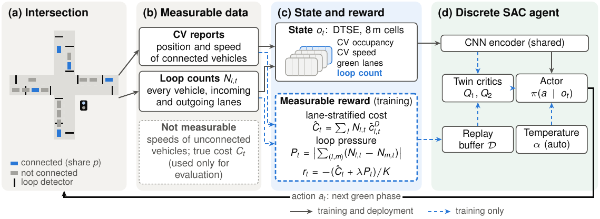
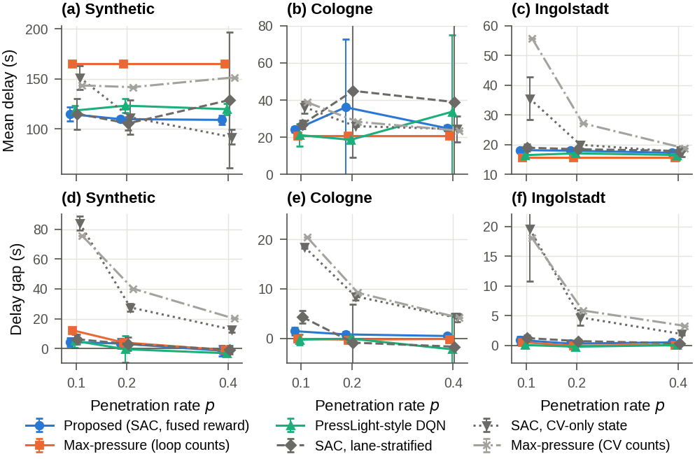

# Training traffic signal controllers on what the road can measure

Code, raw results and figures for the paper *"Training traffic signal controllers on what the road can measure: biases of connected-vehicle rewards and loop–connected vehicle fusion for soft actor-critic"* (M. Sajjad and H. Ali, FAST-NUCES Islamabad).

Most reinforcement learning (RL) signal controllers are trained on a reward computed from **every** vehicle in the simulator, for example the total delay or queue. A real intersection cannot measure that. It only sees

- **connected vehicles (CVs)**, a share *p* of the fleet, which report position and speed, and
- **loop detectors**, which count every vehicle but report nothing else.

This repository studies what goes wrong when the reward is restricted to this measurable data and how to fix it:

1. A CV-only reward has a **scale bias** (for soft actor-critic with a fixed temperature it acts like the temperature divided by *p*) and a **selection bias** (it rewards serving the lanes where CVs happen to be; inverse-probability weighting cannot remove it).
2. The proposed **lane-stratified reward** multiplies each lane's loop count by the mean cost of the CVs on that lane. It is unbiased, and its variance depends only on the variation within a lane. A lane without a CV borrows the mean cost of the CVs on lanes with the same signal indication.
3. The **proposed controller** is discrete SAC trained on the fused reward `r = -(C_str + λ·P) / K` (stratified cost plus loop pressure, λ = 0.5, K = 50), with the loop counts added to the state as a fourth input channel. Every input is available at a real intersection with loops and a CV feed.



## Main results (p = 0.1, mean delay in seconds over five seeds and 20 held-out scenarios)

| Controller | Synthetic | Cologne | Ingolstadt |
|---|---|---|---|
| Max-pressure (loop counts) | 164.8 | **20.9** | **15.7** |
| QM-ATSC (base study, re-implemented) | 196.9 | 143.8 | 35.2 |
| SAC, CV-only state | 151.3 | 36.2 | 35.5 |
| PressLight-style DQN (pressure reward) | 118.3 | 21.2 | 16.5 |
| **Proposed (SAC, loop–CV state, fused reward)** | **114.8** | 24.1 | 18.2 |

On the synthetic intersection the proposed controller cuts the extra delay of unconnected vehicles from 84 s (CV-only state) to 4 s. Max-pressure control with loop counts stays faster on the two isolated real intersections; the paper discusses why. Full tables are in `results/tables/`, and all paired tests are in `results/paired_tests.csv`.



## Repository layout

```
tsc/                 environment, rewards and learners (importable package)
  env.py               synthetic intersection (SUMO), DTSE state, connected-vehicle sampling
  realnet.py           single RESCO intersections (Cologne, Ingolstadt)
  multinet.py          multi-signal RESCO networks, one agent per signal
  rewards.py           measurable cost estimators: naive, IPW, loop count, lane-stratified (+ same-signal fallback)
  pressure.py          loop-based pressure reward and the fused reward
  sac.py, dqn.py       discrete soft actor-critic and double DQN
  baselines.py         fixed time, max-pressure (CV counts or loop counts)
  fu2026.py            QM-ATSC controller of the base study, adapted to our phases
  net/                 SUMO networks and demand, with their licences (see net/SOURCES.md)
scripts/             one task per script
  train.py, train_multi.py, train_fu2026.py      training
  evaluate.py, evaluate_multi.py                  evaluation on the 20 held-out scenarios
  estimator_study.py, estimator_robustness.py     estimator accuracy on recorded snapshots (no learning)
  validate.py                                     scoring on separate validation episodes
experiments/         the experiment stages of the paper, in the order they were run (resumable)
analysis/            statistics, tables and figures from the raw results
runs/                raw results: per-episode evaluation CSVs, training logs, run configs (no model weights)
results/             aggregated results (summary.csv, per_seed.csv, paired and Welch tests, tables/)
figures/             all figures of the paper (PDF and PNG) and the TikZ source of the framework figure
tests/               unit tests of the estimators
```

## Installation

Tested on Ubuntu 24.04 with Python 3.12. SUMO is installed from PyPI together with the other packages, so no system-wide SUMO is needed.

```bash
git clone https://github.com/MuhammadSajjad143/Measurable-Reward-Traffic-Signal-Control.git
cd Measurable-Reward-Traffic-Signal-Control
python3 -m venv .venv
source .venv/bin/activate
pip install -r requirements.txt
python -m pytest tests          # 7 tests of the estimators
```

## Reproduce the tables and figures from the included results

No simulation is needed. The `runs/` folder holds every evaluation episode of the paper.

```bash
python analysis/analyze.py          # results/summary.csv, per_seed.csv, paired_tests.csv, welch_tests.csv
python analysis/make_tables.py      # results/tables/*.tex
python analysis/make_figures.py     # figures/fig_*.pdf and .png
python analysis/final_numbers.py    # per-seed numbers and test-time paired tests quoted in the paper
```

The framework figure is drawn in TikZ: `cd figures && pdflatex framework.tex`.

## Train and evaluate a single model

```bash
# proposed controller on the Cologne intersection at 10% penetration, seed 0
python scripts/train.py --net cologne1 --obs-loop --reward fused_cs --fused-lambda 0.5 \
    --p 0.1 --seed 0 --out runs/demo/fused_cs_p0.1_s0
python scripts/evaluate.py --run runs/demo/fused_cs_p0.1_s0 --p 0.1

# a baseline on the same 20 scenarios
python scripts/evaluate.py --baseline max_pressure_loop --net cologne1 --p 0.1 --out runs/demo/baselines

# robustness at test time: loop-count noise, a failed loop, heavier demand
python scripts/evaluate.py --run runs/demo/fused_cs_p0.1_s0 --p 0.1 --loop-noise 0.1
python scripts/evaluate.py --run runs/demo/fused_cs_p0.1_s0 --p 0.1 --loop-fail
python scripts/evaluate.py --run runs/demo/fused_cs_p0.1_s0 --p 0.1 --demand-scale 1.6
```

Useful options of `train.py`: `--net` (`1tls_3x3`, `cologne1`, `ingolstadt1`), `--reward` (`privileged`, `naive`, `ipw`, `loop_count`, `stratified`, `stratified_cs`, `pressure`, `fused`, `fused_cs`), `--obs-loop` (add the loop-count channel), `--algo` (`sac` or `dqn`), `--alpha` (`auto` or a fixed temperature). Multi-signal networks (`cologne3`, `ingolstadt7`, `cologne8`) use `scripts/train_multi.py` and `scripts/evaluate_multi.py` with the same options. Each evaluation writes `eval_<name>_p<p>[_<condition>].csv` with one row per scenario.

## Run all experiments of the paper

The stages in `experiments/` launch training and evaluation jobs in parallel and skip every job whose output already exists. Because `runs/` already contains the results, they report nothing to do. To run everything from scratch, move `runs/` away first.

| Stage | Script | Content |
|---|---|---|
| 1 | `exp1_main_grid.py` | synthetic intersection, CV-only state, five rewards, fixed and automatic temperature |
| 2 | `exp2_ablations.py` | double DQN check, loop–CV state, uneven penetration, QM-ATSC |
| 3 | `exp3_real_intersections.py` | loop–CV state on Cologne and Ingolstadt, CV-only ablation, sensitivity |
| 4 | `exp4_multisignal_pressure.py` | three-signal network, PressLight-style pressure learners |
| 5 | `exp5_fused_reward.py` | fused reward, λ tuned on validation episodes, held-out seven-signal network |
| 6 | `exp6_same_signal_fallback.py` | same-signal fallback (`fused_cs`), held-out eight-signal network |
| 7 | `exp7_final_model_tests.py` | proposed model at all p, penetration drift, unseen demand, detector errors, heavier demand |
| 8 | `exp8_pressure_seeds.py` | five seeds for the pressure learners |

```bash
python experiments/exp7_final_model_tests.py --gpu-workers 3 --cpu-workers 8
```

One single-intersection training run (180,000 decisions) takes about 0.5–1 h, and a multi-signal run 1–3 h. The full set of experiments is several hundred runs.

## Experimental protocol

- **Simulator:** SUMO 1.28. Training uses the in-process interface (libsumo). Evaluation runs every episode in a fresh SUMO process through TraCI, so repeated evaluations give identical results.
- **Seeds:** training seeds 0–4 (three for secondary and multi-signal experiments); training episodes use seeds `1e6·(seed+1) + episode`; the 20 held-out test scenarios use `9e8 + k`; validation episodes (λ tuning) use `8e8 + k`. Scenarios fix the demand, the connected vehicles and the simulator seed, so every controller sees the same 20 scenarios.
- **Statistics:** each seed is averaged over the 20 scenarios; results are means with 95% t-intervals across seeds, Welch tests across seeds and paired t- and Wilcoxon tests over scenarios.
- **Hyperparameters:** 180,000 decisions (10,000 random), γ = 0.99, Adam 3e-4, batch 128, replay 200,000, τ = 0.005, target entropy 0.5·log|A|, K = 50, λ = 0.5; DTSE of 160 m in 8 m cells with four channels.
- **Hardware used for the paper:** Intel Core i9-14900K, 31 GB RAM, NVIDIA RTX 3090 (24 GB); PyTorch 2.14, Python 3.12, Ubuntu 24.04.

## Data

The synthetic intersection comes from the open code of Ducrocq and Farhi (2023). The real networks and their calibrated demand come from the RESCO benchmark (Ault and Sharon, 2021) and keep their original licences; see `tsc/net/SOURCES.md`. Trained model weights are not included because of their size and are available from the authors on request.

## Citation

If you use this code, please cite the paper (citation details will be added after publication).
